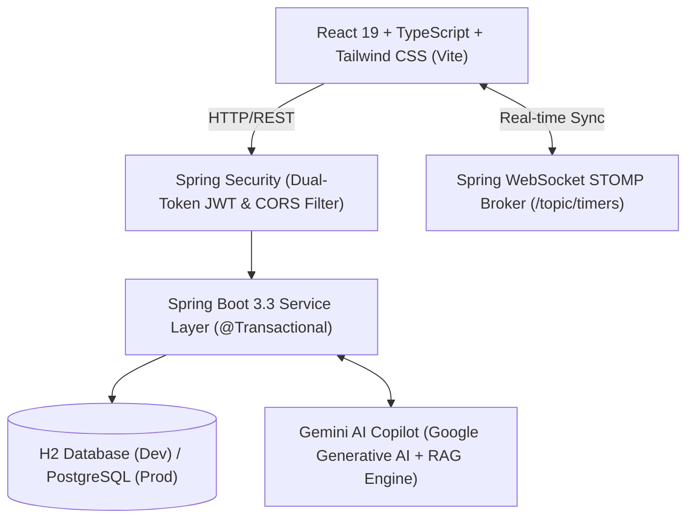

# 🚀 TeamCRM — Enterprise CRM, Sprint Task Management & Server-Side Anti-Tamper Time Tracking Platform

[](https://spring.io/projects/spring-boot)
[](https://www.oracle.com/java/)
[](https://react.dev/)
[](https://www.typescriptlang.org/)
[](https://tailwindcss.com/)
[](LICENSE)

> **TeamCRM** is an all-in-one enterprise platform that unifies **Sales CRM Funnels**, **Jira-lite Engineering Sprint Tasks**, **Server-Authoritative Anti-Tamper Time Tracking**, and a context-aware **Gemini AI Copilot** in a single cohesive system.

---

## 🌟 Why TeamCRM? (The 3-in-1 Advantage)

Most modern companies pay for and struggle with 3 disconnected software silos:
1. **Salesforce / HubSpot** for CRM Deals & Lead Pipelines.
2. **Jira / Asana** for Engineering Sprint Tasks & Bugs.
3. **Clockify / Harvest** for Client Billable Time Tracking.

**TeamCRM consolidates all three into a synchronized architecture:**
- **Zero Data Disconnect:** CRM Deals link directly to Engineering Sprint Tasks, which link directly to Server-Verified Billable Time Logs.
- **Eliminates Time Theft & Fraud:** Browser JS timers can be hacked by changing local computer time. TeamCRM calculates elapsed seconds strictly on a synchronized UTC server clock.
- **Embedded Agentic Gemini AI:** An intelligent Copilot that understands live tasks, database entities, and architecture, providing instant technical guidance and automated sprint task generation.

---

## 🏗️ Architecture & Tech Stack



### Backend Specifications
- **Framework:** Spring Boot 3.3.4, Java 21 LTS
- **Security:** Stateless Dual-Token JWT (24-hour Access, 7-day Refresh) with HMAC-SHA512 + BCrypt password hashing (Cost 10).
- **Persistence:** Spring Data JPA with Hibernate, optimistic locking (`@Version`), and multi-profile support (H2 local file-based / PostgreSQL prod).
- **Real-Time:** Spring WebSocket with STOMP message broker for live timer synchronization and active session broadcasting.
- **API Documentation:** OpenAPI 3 / Swagger interactive documentation at `/swagger-ui.html`.

### Frontend Specifications
- **Framework:** React 19, TypeScript, Vite
- **Styling:** Vanilla CSS design system with Tailwind CSS tokens and responsive flex/grid layouts.
- **Icons:** Lucide React
- **State Management:** React hooks with optimistic UI updates and live cache invalidation.

---

## 👥 Role-Based Access Control (RBAC) Matrix

TeamCRM enforces 3-tier Role-Based Access Control at both the `@PreAuthorize` API controller and frontend UI gating levels:

| Capability / Feature | 🛡️ Admin (`ROLE_ADMIN`) | 👔 Manager (`ROLE_MANAGER`) | 💻 Employee (`ROLE_EMPLOYEE`) |
| :--- | :---: | :---: | :---: |
| **Manage Users & Reset Passwords** | ✅ Full Access | ❌ Restricted | ❌ Restricted |
| **Manage CRM Deals & Pipeline** | ✅ Full Access | ✅ Full Access | ❌ Restricted |
| **Schedule / Edit / Delete Meetings** | ✅ Full Access | ✅ Full Access | 👁️ View Only |
| **Assign Tasks Across Team** | ✅ All Employees | ✅ Team Members | ❌ View Only Own Tasks |
| **Start / Pause Server Timers** | ✅ Yes | ✅ Yes | ✅ Yes (Own Tasks) |
| **Single Active Timer Rule** | ✅ Enforced | ✅ Enforced | ✅ Enforced |
| **View Audit Logs & API Specs** | ✅ Full Access | ❌ Restricted | ❌ Restricted |

---

## ⏱️ Anti-Tamper Server-Authoritative Time Tracking

Traditional client-side time tracking tools (`setInterval()`, `Date.now()`) are easily abused:
- Employees can change their computer clock to log fake hours.
- Closing tabs or sleeping laptops breaks duration tracking.
- Running multiple tabs can double-bill clients.

**TeamCRM Solves This via Server Authority:**
1. **Server Clock Authority:** When a user clicks *Start Timer*, the server records `Instant.now()` from its synchronized UTC hardware clock.
2. **Strict Single-Active-Timer Rule:** An employee can have at most **ONE active timer** running across the entire organization. Starting a new timer automatically calculates elapsed time, pauses the prior task, and persists billable minutes to `task_time_logs`.
3. **Zero Client Tampering:** Altering local computer time or closing the tab has zero effect on billing calculations.
4. **WebSocket Pulse:** Active timer states are broadcast over WebSocket STOMP to synchronize the glowing topbar badge across all open devices.

---

## 🤖 Context-Aware Gemini AI Copilot

Embedded directly into the application, the Gemini AI Copilot provides domain intelligence:
- **Task Deep-Dives:** Explains sprint deliverables (e.g. `CRM-101`), identifies concurrency gotchas, and suggests execution blueprints.
- **Dynamic Checklists:** Automatically generates tailored engineering subtasks for any feature, bug, or query.
- **Pipeline Revenue Forecasting:** Analyzes deal stages (Prospect, Proposal, Negotiation, Won) with weighted close probability formulas.
- **Dual Inference:** Direct Google Generative Language Cloud model via user API key (`🔑`) or native built-in Agentic Knowledge Engine.

---

## 🚀 Quick Start Guide

### Prerequisites
- **Java 21 LTS** or higher
- **Node.js 18+** and npm
- **Maven 3.8+** (or use included `mvnw`)
- **Git**

### 1. Clone the Repository
```bash
git clone https://github.com/Payal-Jadhao/TeamCRM.git
cd TeamCRM
```

### 2. Start the Backend (Spring Boot)
```bash
cd backend
mvn spring-boot:run
```
*The backend starts at `http://localhost:8080` with pre-configured H2 database at `./data/teamcrmdb`.*
- Swagger OpenAPI: `http://localhost:8080/swagger-ui.html`
- H2 Console: `http://localhost:8080/h2-console` (JDBC URL: `jdbc:h2:file:./data/teamcrmdb`, User: `sa`, Password: *blank*)

### 3. Start the Frontend (React + Vite)
```bash
cd ../frontend
npm install
npm run dev
```
*The frontend starts at `http://localhost:5173`.*

---


---

## 📄 License
This project is open-source under the MIT License.
