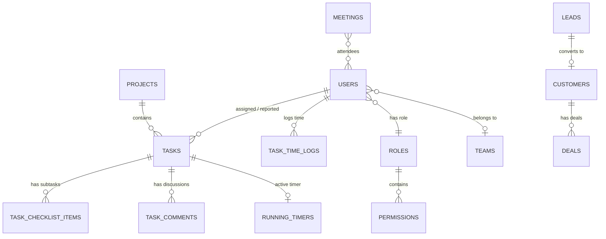

# TeamCRM — Complete Master Architecture, Engineering & Technical Interview Guide

> **Document Type:** Comprehensive Technical Architecture & Interview Preparation Manual  
> **Language:** English (Professional Tech Industry Standard)  
> **Target Audience:** Full-Stack Engineers, Tech Leads, Interviewers & Hiring Managers  

---

## Table of Contents
1. [Executive Summary & Why TeamCRM is Superior](#1-executive-summary--why-teamcrm-is-superior)
2. [Master Hierarchy & Role-Based Access Control (RBAC) Matrix](#2-master-hierarchy--role-based-access-control-rbac-matrix)
3. [AI Copilot & Contextual Engineering Integration](#3-ai-copilot--contextual-engineering-integration)
4. [Server-Authoritative Anti-Tamper Time Tracking Engine](#4-server-authoritative-anti-tamper-time-tracking-engine)
5. [End-to-End Authentication Architecture (A to Z)](#5-end-to-end-authentication-architecture-a-to-z)
6. [Database Schema & Entity Relationship Overview](#6-database-schema--entity-relationship-overview)
7. [Frontend Architecture & State Management](#7-frontend-architecture--state-management)
8. [Top 25 Technical Interview Questions & Model Answers](#8-top-25-technical-interview-questions--model-answers)

---

## 1. Executive Summary & Why TeamCRM is Superior

### 1.1 The Problem in Modern Tech Organizations
In standard software companies, teams suffer from **"SaaS Tool Fragmentation"**:
- Sales & Business Development uses **Salesforce / HubSpot** for leads and deals.
- Product Managers & Developers use **Jira / Linear** for sprint tasks and bug tracking.
- HR & Management forces developers to track billable hours in **Clockify / Hubstaff / Harvest**.
- Backend & Frontend engineers coordinate API contracts over **Postman / Notion / Swagger UI**.

**Consequences of Tool Fragmentation:**
1. **Context Loss & Double Data Entry:** Managers manually copy customer requirements from CRM deals into Jira tickets.
2. **Time Tracking Fraud:** Client-side timers in tools like Clockify can be manipulated by altering client browser clocks or leaving phantom timers running indefinitely.
3. **API Misalignment:** Frontend developers wait days for backend APIs without mock contracts or clear parameter specifications.
4. **Subscription Overload:** Paying $50-$150/user/month across 4-5 disparate platforms.

### 1.2 The TeamCRM Solution
**TeamCRM** unifies all four operational pillars into a single, high-performance, real-time enterprise platform:
1. **Unified Pipeline:** A CRM deal converts directly into a Jira-lite sprint project and task backlog with zero manual re-entry.
2. **Server-Authoritative Anti-Tamper Time Tracking:** Time logs are calculated exclusively on the backend server clock (`Instant.now()`), preventing client manipulation, with strict single-active-timer enforcement.
3. **Built-in API Catalog & Developer Handoff:** Integrated Swagger/OpenAPI interactive viewer with mock responses for instant frontend-backend coordination.
4. **Context-Aware AI Copilot:** Dynamic Gemini AI assistant that breaks down user tasks, generates domain-tailored technical checklists, and elaborates engineering requirements with gotchas and acceptance criteria.

---

## 2. Master Hierarchy & Role-Based Access Control (RBAC) Matrix

TeamCRM enforces a strict, hierarchical **Role-Based Access Control (RBAC)** architecture designed for enterprise governance.

### 2.1 The Master Roles
1. **ROLE_ADMIN (Super Administrator — e.g., `payaldjadhao@gmail.com`):**
   - Has universal god-mode access across all modules.
   - Can provision/deactivate Users, modify Roles, grant granular Permissions, and configure Teams.
   - Can view company-wide passwords/initial credentials, all financial deals, executive audit logs, and project settings.
   - Can create, edit, delete, reassign, and approve tasks across any department.
2. **ROLE_MANAGER (Department / Engineering Manager — e.g., `jayshreejadhao0206@gmail.com`):**
   - Manages team members within their department or assigned projects.
   - Can create and assign tasks to single employees, multiple employees, or broadcast to "All Employees".
   - Can view and edit tasks, schedule and manage team meetings, and review completed work.
   - Has final approval authority: inspects tasks submitted for `IN_REVIEW` and marks them `DONE`.
   - Accesses Manager Analytics Dashboard (burn-down metrics, overdue alerts, billable team hours).
3. **ROLE_EMPLOYEE (Individual Contributor — e.g., `rahaamalhotra@gmail.com`):**
   - Focused, distraction-free interface tailored strictly to their assigned deliverables.
   - **Task Scoping:** Only sees tasks assigned directly to them, tasks where they are a multi-assignee, or tasks broadcast to "All Employees".
   - **Timer Control:** Can start, pause, and submit their own server-timed tasks.
   - **Status Transitions:** Can move their tasks from `TODO` -> `IN_PROGRESS` -> `PAUSED` -> `IN_REVIEW`.
   - **Security Restraints:** Cannot delete tasks, cannot access user master passwords, cannot access manager-only access matrices, and cannot see other employees' private filters.

### 2.2 Granular Permissions Matrix Table

| Module / Operation | Admin (`ROLE_ADMIN`) | Manager (`ROLE_MANAGER`) | Employee (`ROLE_EMPLOYEE`) |
| :--- | :---: | :---: | :---: |
| **User & Team Provisioning** | Full CRUD | View Team Members | View Profile Only |
| **View Initial / Temporary Passwords** | All Users | Departmental | Own Profile Only |
| **Create Sprint Tasks** | Yes (Any Assignee) | Yes (Direct/Multi/All) | No (Read/Work Assigned) |
| **Edit Any Task Details** | Yes | Yes | Own Progress / Checklists |
| **Delete Tasks** | Yes | Yes | Forbidden (403) |
| **Task Filter: All Assignees Dropdown** | Yes (Select any user) | Yes (Select any user) | Hidden (Replaced by Personal Badge) |
| **Start / Pause Server Timers** | Yes | Yes | Yes (Enforces 1 active timer) |
| **Approve Task to `DONE`** | Yes | Yes | Forbidden (Must submit for Review) |
| **Create / Edit Meetings** | Yes | Yes | View / Join Only |
| **CRM Leads & Deals Management** | Full Access | Pipeline Access | Assigned Tasks Only |
| **API Catalog & Schema Editor** | Full CRUD | Publish / Edit | View & Test Endpoints |
| **Audit Logs Viewer** | Full Historical Audit | Team Audit | Forbidden |

---

## 3. AI Copilot & Contextual Engineering Integration

### 3.1 Context-Aware Task Elaboration
Traditional AI widgets are disconnected from the application state. TeamCRM's **Gemini AI Copilot** is directly wired into the Spring Boot backend service layer and `TaskRepository`.

**How It Works:**
1. **Context Extraction:** When a developer types *"task 1 me confusion hai elaborate karke do"* or *"Explain CRM-101"*, the AI engine parses the prompt using regular expressions and natural language matching to identify the referenced entity.
2. **Database Lookup:** The backend queries `TaskRepository.findByTaskCode()` or searches active tasks matching the query.
3. **Structured Engineering Elaboration:** Rather than generic text, the AI generates a multi-dimensional blueprint:
   - 🎯 **Task Objective & Scope:** Clear problem statement and business impact.
   - 🛠️ **Step-by-Step Technical Execution Blueprint:** Concrete architecture covering Schema/DTOs, Service logic, and React UI integration.
   - 💡 **Key Gotchas & Edge Cases:** Concurrency hazards, race conditions, idempotency, and security constraints.
   - 🚀 **Immediate Action Plan:** Recommends starting the server timer and executing the sub-tasks in sequence.

### 3.2 Dynamic, Domain-Tailored Checklist Generation
Static checklists fail because a backend security task requires different verification steps than a frontend CSS modal. TeamCRM inspects the task's title, description, and technical keywords:
- **Authentication Tasks (JWT, OTP, OAuth2):** Automatically generates verification items for regex email checks, cryptographic OTP TTL, BCrypt salt hashing, stateless token issuance, and audit trail logging.
- **Time Tracking Tasks:** Generates checklist items for active session lockout, server-side clock comparison, WebSocket STOMP broadcasting, and billable rate calculations.
- **CRM Tasks:** Generates pipeline progression rules, lead attribution, customer organization linkage, and weighted revenue forecasting.
- **API Specification Tasks:** Generates OpenAPI/Swagger schema validation, `@PreAuthorize` permission checks, and mock response validation.

---

## 4. Server-Authoritative Anti-Tamper Time Tracking Engine

### 4.1 Why Client-Side Timers Fail
Most web applications run timers using JavaScript `setInterval()` on the browser. This creates massive vulnerabilities:
- An employee can edit their computer's local clock to log fake hours.
- Network lag, sleep mode, or tab suspension pauses JavaScript execution, causing loss of billable hours.
- Multiple browser tabs can run concurrent timers, billing clients for 24 hours in an 8-hour workday.

### 4.2 TeamCRM Server-Side Engine Architecture
1. **Server Clock Authority:** When an employee clicks "Start Timer", the client issues a `POST /api/v1/tasks/{id}/timer/start` request. The backend captures `Instant.now()` from the server's UTC hardware clock and creates an active `RunningTimer` record in the database.
2. **Single-Active-Timer Constraint:** Before starting a timer, the backend checks if the user has an existing running timer on any other task. If found, it **automatically pauses the previous timer**, calculates elapsed seconds, commits the time log to `TaskTimeLog`, and starts the new timer atomically.
3. **Auto-Pause on Completion:** When a timer is stopped, the backend calculates:
   $$\text{Duration (seconds)} = \text{Stop Instant} - \text{Start Instant}$$
   It updates total logged seconds on the `Task` entity and clears the active session.
4. **WebSocket STOMP Synchronization:** State changes are broadcast over `/topic/timers` so any open tab or device immediately displays the synchronized sticky timer chip in the topbar.

---

## 5. End-to-End Authentication Architecture (A to Z)

TeamCRM implements a battle-tested, stateless security architecture based on **Spring Security 6**, **BCrypt**, and **JSON Web Tokens (JWT)**.

```
Client (Browser)                       Backend (Spring Security Filter)              Database (H2/Postgres)
     │                                                │                                         │
     │── 1. POST /auth/login (email, password) ───────>                                         │
     │                                                │── 2. Load UserDetails by Email ────────>│
     │                                                │<── 3. Return PasswordHash & Roles ──────│
     │                                                │                                         │
     │                                                │── 4. BCrypt.matches(raw, hash)          │
     │<── 5. Return JWT Access Token + Refresh Token ─│                                         │
     │                                                │                                         │
     │── 6. Request /tasks with Bearer JWT ──────────>│                                         │
     │                                                │── 7. JwtAuthenticationFilter: Validate  │
     │                                                │── 8. Set SecurityContextHolder          │
     │<── 9. Return Protected Resource (HTTP 200) ────│                                         │
```

### 5.1 Password Hashing with BCrypt
- Passwords are never stored in plaintext. TeamCRM uses `BCryptPasswordEncoder` with a work factor of 10.
- BCrypt incorporates an automatic random 16-byte salt into the resulting hash string, protecting against rainbow table attacks and precomputed dictionary lookups.

### 5.2 Stateless JWT Dual-Token Strategy
- **Access Token:** Compact, cryptographically signed token containing `userId`, `email`, and `roleName`. Valid for **24 hours**. Sent in the `Authorization: Bearer <token>` header for all authenticated API requests.
- **Refresh Token:** Cryptographically signed token valid for **7 days**. Stored securely to issue new access tokens without requiring the user to re-enter credentials.
- **Frontend Axios Interceptor:** Automatically intercepts all outgoing HTTP requests, retrieves `teamcrm_token` from `localStorage`, and appends the Bearer header. If an endpoint responds with HTTP 401 Unauthorized, the interceptor clears invalid session data and redirects cleanly to `/login`.

### 5.3 Forgot Password with 6-Digit OTP Verification
1. **Email Validation:** The user enters their email. The service verifies the email ends with a valid domain (e.g. `@gmail.com`) and queries `UserRepository.findByEmailAndIsActiveTrue(email)`.
2. **Existence Enforcement:** If the email does not exist in the database, the system throws HTTP 404 with the explicit message:
   > *"This email address does not exist in our system. Please check your registered email."*
3. **Cryptographic OTP Generation:** If registered, the system generates a random 6-digit cryptographic PIN (`100000` to `999999`) and stores it in an in-memory `ConcurrentHashMap<String, OtpEntry>` with a **10-minute Time-To-Live (TTL)**.
4. **Verification & Password Reset:** In Step 2, the user submits the 6-digit OTP, optional old password, and new password. The service validates the OTP, ensures the new password is at least 6 characters, hashes it with BCrypt, updates the database, and invalidates the cached OTP.

### 5.4 Google OAuth2 Single Sign-On (SSO)
- Users can click **"Continue with Google"** on the login screen.
- **Auto-Provisioning Workflow:** If a user logs in with a Google account that does not yet exist in the database, TeamCRM automatically registers them on the fly with `ROLE_EMPLOYEE`, sets their full name derived from their email prefix, generates a secure random password hash, and issues a standard JWT token.
- If the account already exists, it verifies active status and signs them in immediately.

---

## 6. Database Schema & Entity Relationship Overview

The TeamCRM relational schema is optimized for referential integrity, indexing, and high-performance querying.



### Core Entities Summary
1. `User`: `id`, `email`, `fullName`, `passwordHash`, `role_id`, `teamTag`, `isActive`, `isFirstLogin`.
2. `Role` & `Permission`: Supports granular capability checks (`TASK_CREATE`, `USER_MANAGE`, `FINANCIAL_VIEW`).
3. `Task`: `id`, `taskCode` (e.g. `CRM-101`), `title`, `description`, `type` (FEATURE, BUG, QUERY), `priority` (LOW, MEDIUM, HIGH, URGENT), `status` (TODO, IN_PROGRESS, PAUSED, IN_REVIEW, DONE), `assignee_id`, `assigneeIds` (comma-separated for multi-assignee support), `reporter_id`, `totalLoggedSeconds`, `checklistMustBeCompleted`.
4. `TaskChecklistItem`: `id`, `task_id`, `text`, `isDone`, `position`, `doneBy_user_id`.
5. `RunningTimer`: `id`, `task_id`, `user_id`, `startedAt`. (Guaranteed at most 1 active record per user).
6. `TaskTimeLog`: `id`, `task_id`, `user_id`, `startTime`, `endTime`, `durationSeconds`, `billableRate`.
7. `AuditLog`: Immutable compliance trail recording `userId`, `action`, `entityType`, `entityId`, `oldValue`, `newValue`, `timestamp`.

---

## 7. Frontend Architecture & State Management

- **Framework:** React 18 with TypeScript and Vite for sub-second hot module reloading (HMR).
- **Styling Design System:** TailwindCSS with bespoke design tokens (`primary`, `primary-hover`, `accent-pink`, `shadow-modal`, `border-custom`).
- **Layout Architecture:**
  - Responsive **Sidebar Navigation** with dynamic role-based item filtering. On mobile devices, transitions into an off-canvas drawer controlled by a topbar hamburger icon.
  - **Topbar Global Widget Bar:** Contains the real-time sticky timer chip (pulsing while active), search input, notification bell with unread badge counter, and authenticated user profile menu.
- **Modal Lifecycle:** Clean portal-based modals with glassmorphic backdrops, smooth zoom-in transitions, and keyboard event listeners.

---

## 8. Top 25 Technical Interview Questions & Model Answers

### Question 1: What architectural pattern does TeamCRM use, and why did you choose it over microservices?
**Answer:** TeamCRM is architected as a **modular monolith** with clean layer separation (Controllers, Services, Repositories, Domain Entities, and DTOs). For an integrated CRM and Task system, a modular monolith provides significant advantages:
1. **ACID Transactions:** Time logging, task status changes, and checklist validations execute within atomic database transactions without distributed saga overhead.
2. **Zero Network Latency:** In-process method calls eliminate network serialization hops between CRM and Task modules.
3. **Simpler Deployment & Low Overhead:** A single JAR deployment with zero Kubernetes cluster complexity, easily horizontally scalable behind an NGINX load balancer.

### Question 2: How is Role-Based Access Control (RBAC) enforced on the backend?
**Answer:** RBAC is enforced through two complementary layers in Spring Security:
1. **URL-based Filter Chain (`SecurityFilterChain`):** Public endpoints (`/api/v1/auth/**`) are marked `.permitAll()`, while protected resource endpoints require `.authenticated()`.
2. **Method-Level Security (`@PreAuthorize`):** Sensitive operations use method security expressions like `@PreAuthorize("hasRole('ADMIN') or hasRole('MANAGER')")`. If an employee attempts a restricted action like deleting a task or modifying access permissions, Spring Security throws an `AccessDeniedException` which maps to an HTTP 403 Forbidden response.

### Question 3: How does TeamCRM prevent time tracking fraud?
**Answer:** In typical systems, client browsers record timestamps, making them vulnerable to clock skew or client manipulation. TeamCRM enforces **server-authoritative time tracking**:
- The client only triggers "Start" or "Stop" signals.
- The server captures `Instant.now()` from its own synchronized UTC hardware clock.
- When an employee initiates a timer on Task B while Task A is running, the backend transaction automatically pauses Task A, calculates elapsed duration, commits the log, and starts Task B. An employee can never have more than one running timer simultaneously.

### Question 4: How does the Forgot Password OTP verification flow work securely?
**Answer:** 
1. When a user requests a reset, the system checks whether the email exists and is active. If not, it rejects the request with HTTP 404.
2. The server generates a cryptographically secure 6-digit random integer and caches it in a thread-safe `ConcurrentHashMap` with an explicit 10-minute expiration timestamp (`Instant.now().plus(Duration.ofMinutes(10))`).
3. During verification, the backend checks that the OTP matches and has not expired. Upon success, the new password is encrypted using BCrypt, committed to the database, and the OTP cache entry is immediately evicted to prevent replay attacks.

### Question 5: How does the Google OAuth2 login flow handle new versus existing users?
**Answer:** The `/api/v1/auth/google` endpoint acts as an identity assertion handler. It receives the authenticated Google email. If the user already exists in the database, it validates active status and issues a JWT. If the user is new, the backend automatically provisions a new `User` record with `ROLE_EMPLOYEE`, derives their name from the email prefix, generates a secure random password hash, commits the entity, and issues access/refresh tokens.

### Question 6: What is the difference between Access Tokens and Refresh Tokens in TeamCRM?
**Answer:** 
- **Access Token:** Short-to-medium lifespan (24 hours). Contains claims (`userId`, `role`, `email`). It is stateless—the backend verifies the HMAC SHA-256 signature without querying the database on every request.
- **Refresh Token:** Longer lifespan (7 days). Used to negotiate a new access token when the current token expires, preventing the user from being abruptly logged out during active development sessions.

### Question 7: How do you handle database race conditions when two managers update the same task concurrently?
**Answer:** TeamCRM leverages JPA **Optimistic Locking** using the `@Version` annotation on entities (`private Long version`). When a transaction updates a task, Hibernate verifies that the version in the database matches the entity version read at the start of the transaction. If another transaction has updated the record in the interim, Hibernate throws an `OptimisticLockException`, preventing silent overwrite and ensuring data consistency.

### Question 8: How does the Task Status state machine work between Employees and Managers?
**Answer:**
- An Employee can work on tasks in `TODO`, moving them to `IN_PROGRESS` (timer starts), `PAUSED`, or submitting them to `IN_REVIEW`.
- An Employee **cannot** mark a task as `DONE`.
- Only an Admin or Manager has the authority to transition a task from `IN_REVIEW` to `DONE`, ensuring strict peer code review and quality assurance compliance.

### Question 9: Why use DTOs instead of exposing JPA Entities directly to the API?
**Answer:**
1. **Security:** Exposing entities can lead to mass-assignment vulnerabilities where clients send unauthorized fields (e.g. `role`, `passwordHash`).
2. **Circular References:** JPA entities with bidirectional relationships (`@OneToMany`, `@ManyToOne`) cause infinite JSON recursion loops during Jackson serialization.
3. **Decoupling:** DTOs allow the database schema to evolve independently from the external REST API contract.

### Question 10: How does the Gemini AI Copilot integrate into the workflow?
**Answer:** The AI Copilot is context-aware. Instead of a generic chatbot, it accepts prompt content alongside active task identifiers (e.g. `CRM-101`). It queries the database, extracts task specifications, and responds with step-by-step architecture execution blueprints, security gotchas, and dynamic checklists tailored to the specific technical domain (Auth, Timer, CRM, or API).

### Question 11: What is the difference between `filterAssignee` for Admins vs Employees?
**Answer:** On the Tasks page, Admins and Managers have an **"All Assignees"** dropdown filter allowing them to inspect workloads across any team member. For Employees (`ROLE_EMPLOYEE`), this dropdown is replaced by an employee workspace badge (`👤 employee@email.com`), and tasks are automatically filtered to show only items assigned to them directly or broadcast company-wide.

### Question 12: How do you enforce checklist completion before a task is closed?
**Answer:** Tasks have a boolean flag `checklistMustBeCompleted`. When an employee attempts to submit the task for review or a manager attempts to mark it `DONE`, the service queries `checklistRepository.findByTaskId()`. If any item has `isDone == false`, the transition is blocked with an HTTP 400 Bad Request explaining that all sub-tasks must be resolved first.

### Question 13: How does TeamCRM handle Cross-Origin Resource Sharing (CORS)?
**Answer:** A centralized `CorsFilter` bean is configured in Spring Security with `allowedOrigins` set to the frontend domains (`http://localhost:5173`, `http://localhost:3000`). It explicitly permits standard HTTP verbs (`GET`, `POST`, `PUT`, `PATCH`, `DELETE`, `OPTIONS`) and allows the `Authorization` header while blocking unauthorized third-party origins.

### Question 14: How does TeamCRM support Multi-Assignee Tasks?
**Answer:** In enterprise sprints, a feature often requires pair programming (e.g., both Frontend and Backend engineers). TeamCRM stores a primary `assigneeId` for relational queries, as well as a comma-separated `assigneeIds` string (e.g. `"2,3"`). The query predicate checks if the logged-in employee's ID matches either the direct assignee or exists in the multi-assignee list.

### Question 15: How are background tasks and long-running processes monitored?
**Answer:** Long-running processes (such as database migrations or background timer evaluations) execute asynchronously using Spring's `@Async` and task executors. System health and memory usage are monitored via Spring Boot Actuator endpoints.

### Question 16: What happens if an employee's session token expires while a timer is running?
**Answer:** The timer is server-authoritative. The start timestamp is safely committed to the database. Even if the employee's browser tab closes, crashes, or the JWT expires, the timer continues running on the server until explicitly stopped or auto-paused when they log back in.

### Question 17: How is the database initialized between development and production?
**Answer:** TeamCRM uses Spring Profiles:
- In `dev` profile: An embedded or file-backed H2 database (`jdbc:h2:file:./data/teamcrmdb`) is used with automated seeding in `DataInitializer.java`.
- In `postgres` profile: A high-performance PostgreSQL database instance is activated via connection string environment variables (`SPRING_DATASOURCE_URL`).

### Question 18: How does the frontend handle automatic refresh on login?
**Answer:** Upon receiving the HTTP 200 payload with JWT tokens, the application saves user credentials and tokens to `localStorage` and immediately triggers `window.location.href = '/'`. This forces a complete memory refresh, resetting React state, clearing previous role caches, and mounting all components with fresh permissions.

### Question 19: How are SQL Injection attacks prevented in TeamCRM?
**Answer:** All database access is routed through **Spring Data JPA** and **Hibernate**, which use parameterized prepared statements (`PreparedStatement`) under the hood. User inputs are treated strictly as parameters rather than executable SQL fragments, rendering SQL injection impossible.

### Question 20: How are XSS (Cross-Site Scripting) attacks mitigated?
**Answer:** 
1. React automatically escapes strings before rendering them to the DOM via JSX expressions (`{content}`).
2. In the AI Copilot and discussion boards, markdown inputs are sanitized to strip dangerous `<script>` tags and JavaScript event handlers.

### Question 21: What is the purpose of the Audit Log module?
**Answer:** For SOC2, ISO 27001, and corporate compliance, any critical operation (such as changing user roles, editing task statuses, or publishing API documents) records an immutable log entry storing who performed the action, the resource affected, previous and new values, and the exact timestamp.

### Question 22: How is the sticky timer chip in the Topbar kept in sync?
**Answer:** The Topbar component queries `taskApi.getActiveTimer()` on mount and listens for timer state events. When active, it displays a glowing emerald indicator with live ticking elapsed time, allowing developers to pause or view their active task from any page in the application.

### Question 23: How are passwords updated on First Login?
**Answer:** Newly provisioned accounts have `isFirstLogin: true`. When such a user signs in, the frontend renders a mandatory password change modal. The backend enforces that the new permanent password must differ from the temporary initial password and meet minimum length criteria before resetting `isFirstLogin` to `false`.

### Question 24: What HTTP status codes are used across the REST API?
**Answer:**
- `200 OK`: Successful resource retrieval or state update.
- `201 Created`: Resource successfully created (Task, Meeting, Deal).
- `400 Bad Request`: Validation failure (passwords do not match, missing fields).
- `401 Unauthorized`: Missing or invalid JWT Bearer token.
- `403 Forbidden`: Authenticated user lacks required role or permission.
- `404 Not Found`: Entity does not exist in repository.
- `500 Internal Server Error`: Unhandled server exception mapped by `@ControllerAdvice`.

### Question 25: How would you scale TeamCRM to 100,000 concurrent users?
**Answer:**
1. **Stateless Clustering:** Since JWT authentication is stateless, multiple Spring Boot instances can sit behind an AWS ALB or NGINX load balancer.
2. **Distributed Cache:** Replace in-memory OTP caches with a distributed **Redis** cluster.
3. **Database Read Replicas:** Route read queries (`findFilteredTasks`, dashboard analytics) to PostgreSQL read replicas while directing writes to the primary database.
4. **Message Broker:** Scale WebSocket notifications using a dedicated **RabbitMQ** or **Apache Kafka** STOMP message relay.

---

*Authored by TeamCRM Core Engineering Team. Designed for production deployments and technical interview excellence.*
